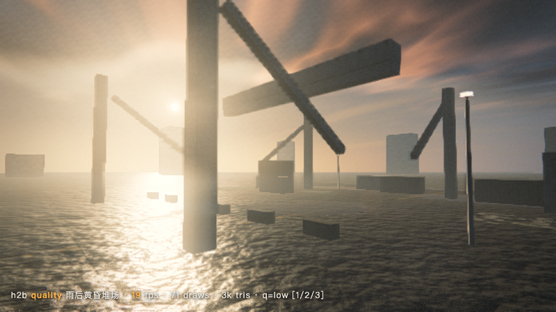
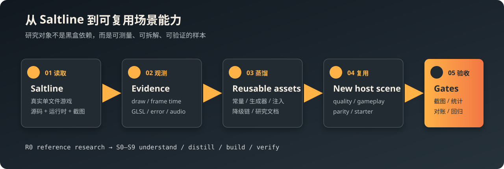
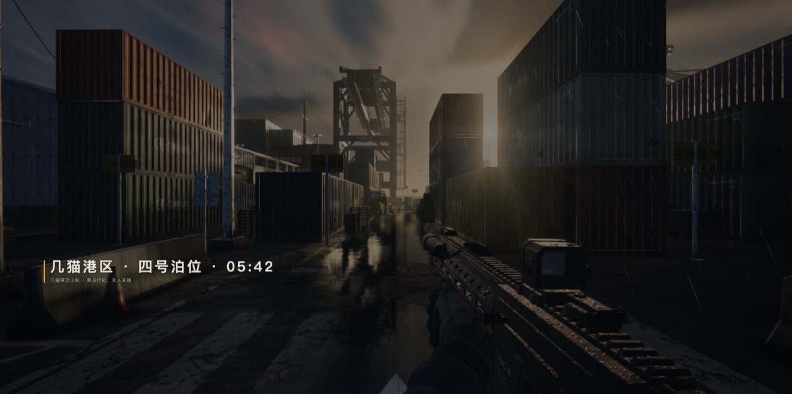
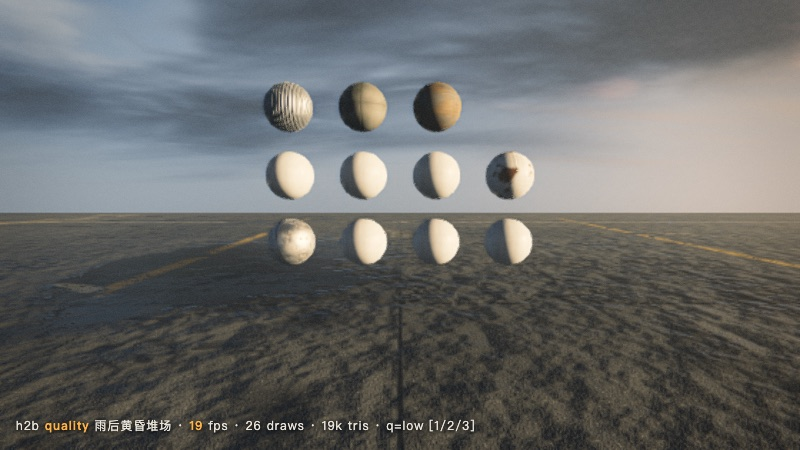
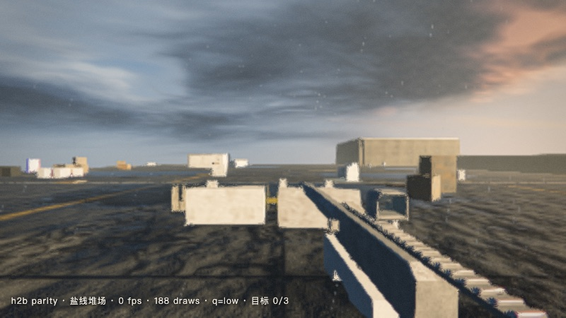

# how2build3d

A Three.js 3D scene skill distilled from Saltline: reusable GLSL, single-file examples, and real rendering gates.

[简体中文](README.md) · **English** · [Quick Start](#quick-start) · [How distillation works](#how-distillation-works) · [How to use it](#how-to-use-it) · [Noncommercial license](LICENSE)



## Contents

- [What this is](#what-this-is)
- [Visual overview](#visual-overview)
- [Source and boundary](#source-and-boundary)
- [How distillation works](#how-distillation-works)
- [What was distilled](#what-was-distilled)
- [Evidence frames](#evidence-frames)
- [Quick Start](#quick-start)
- [How to use it](#how-to-use-it)
- [Verification and failure boundaries](#verification-and-failure-boundaries)
- [Reading guide](#reading-guide)
- [Creation guide](.distill/creation/00-index.md)
- [Contributing and license](#contributing-and-license)

## What this is

`how2build3d` is not a runtime dependency of Saltline and it is not the original project repackaged under a new directory. It uses Saltline's single-file Three.js game as a **research specimen**: reproduce the real frame and runtime first, decompose its rendering, material, gameplay, audio and inspection patterns, then package the transferable parts as a skill, reusable assets, examples and gates.

In one sentence: **Saltline is the specimen; how2build3d is the “understand → distill → build → verify” workflow extracted from it.**

It serves three audiences:

- Scene builders: start with [starter](examples/starter/) and add quality and gameplay systems incrementally.
- Rendering engineers: choose reusable sky, material, wet-ground, post-processing and gameplay modules from the [asset index](assets/index.md).
- Teams that need evidence: use `__stats()`, fixed seeds, inspection galleries and `harness/gates/` instead of judging a frame by feel alone.

## Visual overview



The diagram is the project’s central route. We do not begin with the vague goal of “make a nice 3D scene”. We begin with a reproducible specimen, capture runtime evidence, turn observations into transferable mechanisms, and use new scenes to prove that the mechanisms work outside the specimen.

## Source and boundary

The research object is Saltline’s single-file Three.js implementation. The fixed version and provenance are documented in [PROVENANCE.md](PROVENANCE.md). Upstream entry points:

- [Saltline case page](https://claude.ai/artifact/BGY1SztrAYcJQHSsnHHGmp)
- [Three Games collection](https://claude.ai/artifact/MXxb36zKgN261ckbGhmNin)
- [Megasu research version](https://github.com/Megasu/jimao-3a-game)

> [!NOTE]
> The development source keeps the frozen research fixture under `sources/`; the public snapshot explicitly excludes it. The public repository distributes cited notes, distilled modules and runnable examples. The original fixture is not required to run a public example.

This boundary serves three purposes:

1. **Traceability:** `[src:L…]` and `[src:pretty:L…]` citations point to the frozen version used for each claim.
2. **Non-copying use:** examples consume organized modules from `assets/`, `references/` and `examples/` instead of treating the original game as a black-box dependency.
3. **Clear licensing:** Saltline-related ports, Three.js and this project’s license are recorded separately in [THIRD_PARTY_NOTICES](THIRD_PARTY_NOTICES). Three.js MIT does not become a license for the Saltline original.

## How distillation works

### 1. Read: obtain runtime evidence first

We launch the frozen specimen with system Chrome and WebGL2, then capture frames, draw calls, programs, frame time, final GLSL, runtime errors and audio/gameplay reports. The evidence order is **runtime measurements > captured final GLSL > static source > comments**. This separates “the code contains it” from “the browser actually ran it”.

### 2. Decompose: split the frame into systems

Saltline’s behavior is grouped by the problem it solves rather than left as a pile of source line numbers: procedural sky and sea haze, PCSS shadows, wet-ground reflection, material and texture generation, full-screen post-processing, procedural props, enemies/weapons/player, synthesized audio, HUD and the author’s inspection-gallery loop. Each system keeps its source-line and runtime evidence.

### 3. Distill: converge on five reusable outputs

Distillation here does not mean turning observations into prose. It produces five things a new scene can consume:

| Output | Question it answers | Repository location |
| --- | --- | --- |
| Constant tables | Which quantities, thresholds and quality tiers shape the result? | `references/`, `*_TUNE_DEFAULTS` in kits |
| Generators | How do we make textures, props and audio without external assets? | `assets/sl-textures.mjs`, `assets/props-kit.mjs`, `assets/audio-kit.mjs` |
| Injection skeletons | How do sky, materials, shadows, wet ground and post-processing enter Three.js? | `assets/*.glsl`, `assets/sl-surface.mjs` |
| Fallback chains | What still renders when a shader or browser capability fails? | `references/00-workflow.md`, scene quality tiers |
| Runnable assets | Can a new project call it instead of merely reading it? | `assets/`, `examples/quality/`, `examples/parity/` |

### 4. Build: reuse assets before wiring the scene

New scenes follow `R0 → S0–S9`: research and a GAP table come first, budgets precede content, the [asset router](assets/index.md) is consulted before implementation, and the scene layer owns parameters, layout and event wiring instead of copying shader mathematics.

### 5. Verify: prove that it works

Every scene exposes `window.__G`, `window.__stats()`, a fixed seed, `?bench` and `?show=<gallery>`. Gates inspect structure, runtime behavior, frames, performance, element parity and audio. A result that is “green” in engineering checks but visually empty should be stopped by the visual or asset gates.

Read the full [S0–S9 workflow](references/00-workflow.md), [reference research guide](references/05-reference-research.md) and [distillation index](.distill/00-index.md).

## What was distilled

| Observed capability in Saltline | Public distilled asset | Runnable consumer | Proof |
| --- | --- | --- | --- |
| Clouds, sun-through-clouds, lightning and sea haze | [sky-deck.glsl](assets/sky-deck.glsl), [sea.glsl](assets/sea.glsl) | [quality](examples/quality/), [parity](examples/parity/) | WebGL2 render and gallery frames |
| Triplanar materials, ORM, normals, wet marks and drips | [sl-surface.mjs](assets/sl-surface.mjs), [sl-textures.mjs](assets/sl-textures.mjs) | `quality` material and ground galleries | Asset and visual gates |
| Soft shadows, wet reflection and full-screen look | [pcss-shadow.glsl](assets/pcss-shadow.glsl), [ssr-wet.glsl](assets/ssr-wet.glsl), [post-chain.glsl](assets/post-chain.glsl), [post-aa.glsl](assets/post-aa.glsl) | `quality`, `parity` | Fixed-camera frames and draw/frame-time stats |
| Physics, layout, tokenized combat and hearing | [physics-kit.mjs](assets/physics-kit.mjs), [level-kit.mjs](assets/level-kit.mjs), [combat-kit.mjs](assets/combat-kit.mjs) | [gameplay](examples/gameplay/) | Automated battle report and deterministic hash |
| Props, FX, weapons, enemies, player, HUD, weather and audio | `assets/*-kit.mjs` | `parity` host scene | 18-family parity, audio bands and galleries |
| The author’s own “studio” for iterative comparison | [inspect-deck.mjs](assets/inspect-deck.mjs) | `?show=mats|props|...` | `harness/gates/inspect.mjs` |

## Evidence frames

These are not concept art. The first frame is the research benchmark; the others are real consumers of distilled assets in new hosts.

<table>
  <tr>
    <td><br><sub>Research benchmark: frozen Saltline reference frame</sub></td>
    <td><br><sub>Rendering consumer: quality, eight look systems</sub></td>
  </tr>
  <tr>
    <td><br><sub>Inspection gallery: materials can be entered, captured and regressed independently</sub></td>
    <td><br><sub>Full host: parity, element kits and sea pass</sub></td>
  </tr>
</table>

The smaller [gameplay frame](media/gameplay.jpg) shows the intentionally silent three-kit training scene. For a real audio threshold, run `parity --require-audio`; do not lower the bar because the training sample is silent.

## Quick Start

You need Node.js 20+, npm and a WebGL2 browser. The first dependency install needs network access:

```bash
git clone https://github.com/MicTx/how2build3d.git
cd how2build3d
npm ci --prefix harness
node examples/starter/build.mjs --assert
```

Open `build/index.html` in a browser. The `h2b starter` label, frame rate and seed at bottom left show that the single-file scene is running. Three.js r180 is inlined at build time, so the page needs no CDN or runtime external request.

To reproduce the hero frame:

```bash
node examples/quality/build.mjs --assert
open build/quality/index.html          # macOS; open it in a browser elsewhere
node harness/render/scene.mjs --scene examples/quality --assert
```

The last command uses system Chrome to check WebGL2, runtime errors, the frame loop and draw calls, and writes `evidence/frames/quality.png`.

## How to use it

### A. Use it as an agent skill

To read the method or modify an example, start with [SKILL.md](SKILL.md). To install it for a local agent:

```bash
bash scripts/install-skill.sh
bash scripts/install-skill.sh --check
```

The installer writes a managed copy into the Magpie skill library and links the DSH skill directory to this checkout without replacing unrelated directories. Rerun install and check after updates; uninstall with `bash scripts/install-skill.sh --uninstall`.

Give the agent an acceptance target, not just “make it look good”:

```text
Build a rainy harbor scene. First complete R0: at least three sources,
a coverage matrix and a GAP table. Route materials, sky, wet ground and
post-processing through how2build3d/assets. Deliver a single-file HTML,
low/medium/high tiers, __stats(), one inspection gallery, and a fixed-seed
Chrome frame with draw calls, frame time and fallback results.
```

### B. Reuse it in your Three.js project

Do not copy the entire repository into an application at once:

1. Read [reference research](references/05-reference-research.md) and create sources, the 16-category plan and a GAP table for your scene.
2. Choose systems from the [asset index](assets/index.md); if a system does not apply, record the reason in `scene.elements.json`.
3. Inject assets through your renderer, camera, event bus and quality tiers; the modules under `assets/` take context as parameters rather than importing application state.
4. Build `build/<scene>/index.html`, then expose `__G`, `__stats()`, `?bench`, `?show=` and error markers.
5. Use [quality](examples/quality/) for rendering, [gameplay](examples/gameplay/) for the three gameplay kits, and [parity](examples/parity/) for full assembly and element accounting.

### C. Choose an example by goal

| Goal | Entry point | What it teaches |
| --- | --- | --- |
| Assemble a scene from scratch | [starter](examples/starter/) | Single-file build, boot order, quality fallback and `window.__stats()` |
| Fix plastic-looking materials | [quality](examples/quality/) | SL material/texture layers, wet ground, sky, PCSS, SSR, post chain and galleries |
| Add gameplay | [gameplay](examples/gameplay/) | Physics, hand-authored layout, combat tokens, hearing and determinism |
| Build a full host | [parity](examples/parity/) | Eight element kits, sea pass, HUD/weather/audio and 18-family accounting |

## Verification and failure boundaries

The public snapshot can run these checks independently:

```bash
node harness/gates/doc.mjs --all-tracked
node harness/gates/assets.mjs --scene examples/quality
node harness/render/starter.mjs --assert
node examples/parity/build.mjs --assert
node harness/gates/gameplay.mjs --scene examples/parity --require-audio
```

`examples/gameplay` is intentionally silent. Audio verification must use `examples/parity --require-audio`. `node harness/verify.mjs --static` and `--full` also validate citation evidence in the development checkout; they require the unpublished Saltline fixture and are not prerequisites for the public snapshot.

Use the [workflow failure table](references/00-workflow.md) for diagnosis: inspect the material/visual checklist for plastic surfaces, add `ssr-wet` for dry ground, use the stock fallback when shader anchors change, and lower scale/tex/volSteps before cutting content when frame time exceeds budget.

## Reading guide

- [SKILL.md](SKILL.md): triggers, rules, R0–S9 stages and acceptance contract.
- [references/00-workflow.md](references/00-workflow.md): the execution order from understanding through distillation and build.
- [references/05-reference-research.md](references/05-reference-research.md): sources, coverage matrix, 16 categories and GAP template.
- [references/07-perceptual-quality.md](references/07-perceptual-quality.md): materials, lighting, post-processing and the four screenshot questions.
- [references/08-self-inspection.md](references/08-self-inspection.md): nine-gallery protocol and audio self-check.
- [references/12-full-scene-assembly.md](references/12-full-scene-assembly.md): assembly order from world constants to the full host.
- [assets/index.md](assets/index.md): reusable GLSL, material/texture factories and element-kit interfaces.
- [PROVENANCE.md](PROVENANCE.md): research object, fixed version, citations and public boundary.

## Contributing and license

Read [CONTRIBUTING.md](CONTRIBUTING.md) and [CODE_OF_CONDUCT.md](CODE_OF_CONDUCT.md) before opening a change. Use the private channel in [SECURITY.md](SECURITY.md) for security concerns; do not paste credentials or the raw research fixture into public issues. See [CHANGELOG](CHANGELOG) for release notes.

The project uses [PolyForm Noncommercial 1.0.0](LICENSE); commercial use requires separate written authorization. Three.js is MIT-licensed. Attribution, status and distribution boundaries for Saltline-related ports and this project are in [THIRD_PARTY_NOTICES](THIRD_PARTY_NOTICES).
