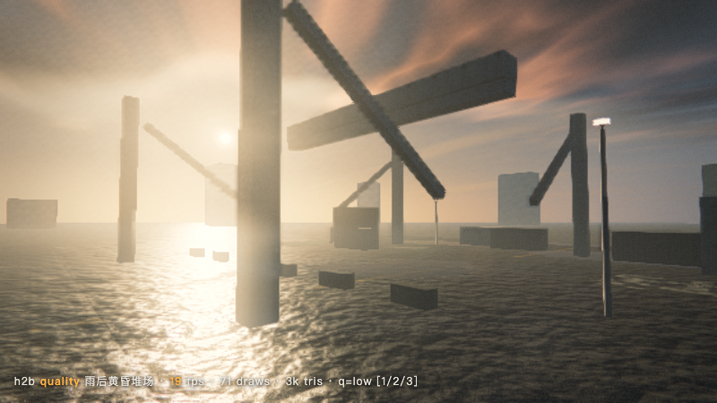
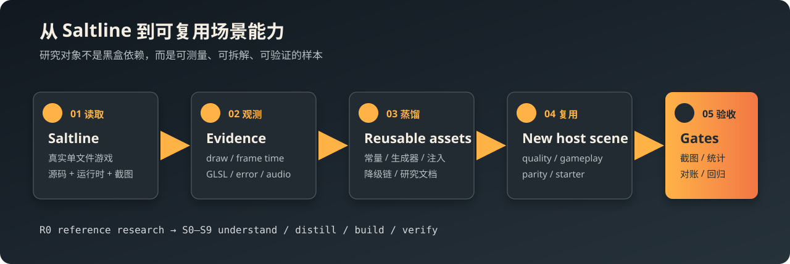
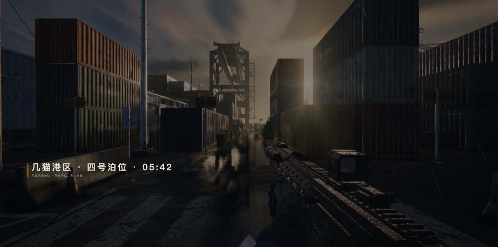
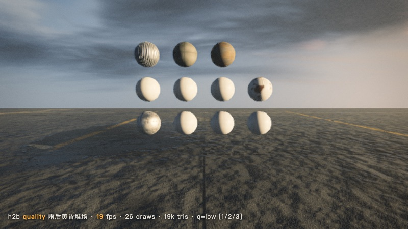
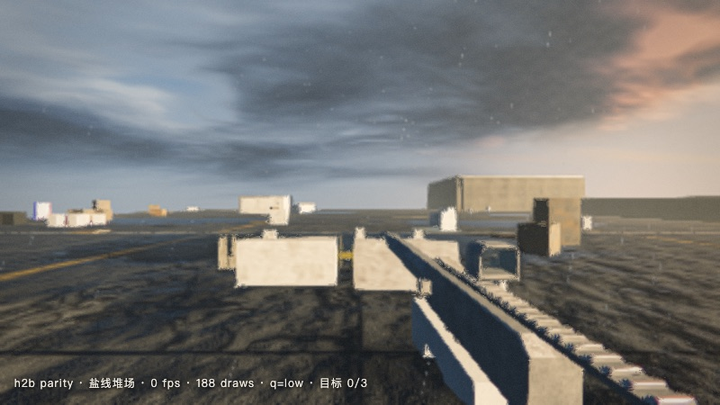

# how2build3d

Three.js 3D 场景开发 Skill：蒸馏 Saltline 的渲染方法、可复用 GLSL 与真实验收门禁。

**简体中文** · [English](README.en.md) · [快速开始](#快速开始) · [蒸馏方法](#蒸馏方法) · [如何使用](#如何使用) · [非商业许可](LICENSE)



## 目录

- [这是什么](#这是什么)
- [图文总览](#图文总览)
- [来源与边界](#来源与边界)
- [蒸馏方法](#蒸馏方法)
- [蒸馏出了什么](#蒸馏出了什么)
- [真实证据](#真实证据)
- [快速开始](#快速开始)
- [如何使用](#如何使用)
- [验证与故障边界](#验证与故障边界)
- [文档地图](#文档地图)
- [创物篇](.distill/creation/00-index.md)
- [贡献与许可](#贡献与许可)

## 这是什么

`how2build3d` 不是 Saltline 的运行时依赖，也不是把原项目换个目录重新发布。它以 Saltline 的单文件 Three.js 游戏为**研究对象**：先复现真实画面和运行时，再拆出可验证的渲染、材质、玩法、音频与自检规律，最后整理成能在新场景中复用的 Skill、资产、示例和门禁。

一句话理解：**Saltline 是被研究的样本；how2build3d 是从样本中提炼出的“理解 → 蒸馏 → 构建 → 验收”工作流。**

项目面向三类人：

- 想从零做 Three.js 场景的人：从 [starter](examples/starter/) 开始，逐步接入质量与玩法系统。
- 想复用成熟渲染机制的人：从 [资产索引](assets/index.md) 选择天空、材质、湿地、后处理、玩法 kit 等模块。
- 想让画面可审查、可回归的人：使用 `__stats()`、固定 seed、展厅截图和 `harness/gates/` 门禁，而不是只凭肉眼判断“像不像”。

## 图文总览



上图是本项目的核心路线。我们不从抽象的“做一个好看的 3D 场景”开始，而是从一个可复现的真实样本开始：读取其结构，捕获运行时证据，分解成可迁移的机制，再用新场景证明这些机制确实可用。

## 来源与边界

研究对象是 Saltline 单文件 Three.js 实现，来源和固定版本见 [PROVENANCE.md](PROVENANCE.md)。相关上游入口：

- [Saltline 原作案例页](https://claude.ai/artifact/BGY1SztrAYcJQHSsnHHGmp)
- [Three Games 合集](https://claude.ai/artifact/MXxb36zKgN261ckbGhmNin)
- [Megasu 收录的研究版本](https://github.com/Megasu/jimao-3a-game)

> [!NOTE]
> 开发真源的 `sources/` 目录只保存冻结研究夹具，公开快照明确排除它。公开仓库分发的是带出处引用的研究笔记、蒸馏后的模块和可运行示例；原始夹具不是运行公开示例的前置条件。

这条边界有三个目的：

1. **保留可核对性**：研究笔记中的 `[src:L…]` / `[src:pretty:L…]` 指向冻结版本，读者可以知道结论来自哪里。
2. **避免复制式使用**：示例通过 `assets/`、`references/` 和 `examples/` 重新组织能力，不把原游戏当成黑盒依赖。
3. **明确授权范围**：Saltline 相关移植资产、Three.js 和本项目许可证分别登记在 [THIRD_PARTY_NOTICES](THIRD_PARTY_NOTICES)；不要把 Three.js 的 MIT 许可误套到 Saltline 原作上。

## 蒸馏方法

### 1. 读取：先取得真实证据

用系统 Chrome + WebGL2 启动冻结样本，采集截图、draw call、program、帧时、最终 GLSL、运行时错误和音频/玩法报告。证据优先级是：**运行时实测 > 捕获的最终 GLSL > 静态源码 > 注释**。这样能区分“代码里写了”与“浏览器真的跑了”。

### 2. 分解：把画面拆成系统

把 Saltline 的大块行为按问题归类，而不是按原文件行号堆在一起：程序化天空与海雾、PCSS 软阴影、湿地反射、材质/纹理生成、全屏后处理、程序化道具、敌人/武器/玩家、合成音频、HUD 和摄影棚式自检。每个系统都保留原始行号与运行时证据。

### 3. 蒸馏：收敛成五种可复用产物

项目的蒸馏不是把观察写成散文，而是固定成五种可以被新场景消费的东西：

| 产物 | 解决的问题 | 仓库落点 |
| --- | --- | --- |
| 常量表 | 哪些数量、阈值和画质档决定结果 | `references/`、各 kit 的 `*_TUNE_DEFAULTS` |
| 生成器 | 没有外部贴图/模型时如何稳定生成纹理、道具和音频 | `assets/sl-textures.mjs`、`assets/props-kit.mjs`、`assets/audio-kit.mjs` |
| 注入骨架 | 如何把天空、材质、阴影、湿地和后处理接进 Three.js | `assets/*.glsl`、`assets/sl-surface.mjs` |
| 降级链 | 高级 shader 或浏览器能力失败时怎样仍然出画 | `references/00-workflow.md`、各场景质量档 |
| 可运行资产 | 新项目能否直接调用，而不是只能阅读 | `assets/`、`examples/quality/`、`examples/parity/` |

### 4. 构建：先复用资产，再接线

新场景按 `R0 → S0–S9` 推进：参考研究和 GAP 表先行，预算先于内容，先查 [资产路由](assets/index.md)，再做场景装配；场景层只负责参数、布局和事件接线，不复制一份难以维护的 shader 数学。

### 5. 验收：证明“真的能用”

每个场景都暴露 `window.__G`、`window.__stats()`、固定 seed、`?bench` 和 `?show=<gallery>`。门禁同时看结构、运行时、截图、性能、元素对账和音频；任何一个“工程全绿但画面空壳”的结果都应在视觉或资产门禁处被拦下。

完整方法论见 [工作流 S0–S9](references/00-workflow.md)、[参考研究](references/05-reference-research.md) 和 [蒸馏索引](.distill/00-index.md)。

## 蒸馏出了什么

| Saltline 中观察到的能力 | 蒸馏后的公开资产 | 可运行消费者 | 证明方式 |
| --- | --- | --- | --- |
| 云层、太阳烧穿、闪电、海雾 | [sky-deck.glsl](assets/sky-deck.glsl)、[sea.glsl](assets/sea.glsl) | [quality](examples/quality/)、[parity](examples/parity/) | WebGL2 渲染、展厅截图 |
| 三平面材质、ORM、法线、湿痕、流挂 | [sl-surface.mjs](assets/sl-surface.mjs)、[sl-textures.mjs](assets/sl-textures.mjs) | `quality` 的材质与地面展厅 | `assets` 门禁、`visual` 门禁 |
| 软阴影、湿地反射、全屏观感 | [pcss-shadow.glsl](assets/pcss-shadow.glsl)、[ssr-wet.glsl](assets/ssr-wet.glsl)、[post-chain.glsl](assets/post-chain.glsl)、[post-aa.glsl](assets/post-aa.glsl) | `quality`、`parity` | 固定机位截图、draw/帧时统计 |
| 物理、布局、令牌化战斗和听觉传播 | [physics-kit.mjs](assets/physics-kit.mjs)、[level-kit.mjs](assets/level-kit.mjs)、[combat-kit.mjs](assets/combat-kit.mjs) | [gameplay](examples/gameplay/) | 自动战斗报告、确定性 hash |
| 道具、FX、武器、敌人、玩家、HUD、天气、音频 | `assets/*-kit.mjs` | `parity` 宿主场景 | 18 族元素对账、音频频段、展厅 |
| 作者自己的“摄影棚”与反复对拍 | [inspect-deck.mjs](assets/inspect-deck.mjs) | `?show=mats|props|...` | `harness/gates/inspect.mjs` |

## 真实证据

下面的图不是概念稿，而是仓库门禁采集的真实帧：第一张是研究基准，其他是蒸馏资产在新宿主中的实际消费者。

<table>
  <tr>
    <td><br><sub>研究基准：Saltline 冻结版本的参考帧</sub></td>
    <td><br><sub>渲染链消费者：quality，八套观感系统</sub></td>
  </tr>
  <tr>
    <td><br><sub>自检展厅：材质可以单独进入、截图、回归</sub></td>
    <td><br><sub>完整宿主：parity，元素 kit 和海面 pass</sub></td>
  </tr>
</table>

玩法链路另有一个更小、更容易阅读的 [gameplay 截图](media/gameplay.jpg)：它故意使用静音三 kit 训练场；真实音频门槛跑 `parity --require-audio`，不要因为训练样本静音而降低标准。

## 快速开始

需要 Node.js 20+、npm 和支持 WebGL2 的浏览器。从仓库根目录执行；首次安装依赖需要联网：

```bash
git clone https://github.com/MicTx/how2build3d.git
cd how2build3d
npm ci --prefix harness
node examples/starter/build.mjs --assert
```

用浏览器打开 `build/index.html`。左下角出现 `h2b starter`、帧率与 seed，说明单文件场景已经启动。Three.js r180 在构建时内联，页面不需要 CDN 或运行时外链。

复现首图：

```bash
node examples/quality/build.mjs --assert
open build/quality/index.html          # macOS；其他系统直接用浏览器打开
node harness/render/scene.mjs --scene examples/quality --assert
```

最后一条会用系统 Chrome 检查 WebGL2、运行时错误、帧循环和 draw call，并生成 `evidence/frames/quality.png`。

## 如何使用

### A. 把它当作 Agent Skill

只想读方法或改示例，直接打开 [SKILL.md](SKILL.md)。要安装到本机 Agent：

```bash
bash scripts/install-skill.sh
bash scripts/install-skill.sh --check
```

安装器把受管副本写入 Magpie 技能库，并在 DSH 技能目录建立指向当前仓库的链接；不会替换无关目录。更新后重跑安装和检查，卸载使用 `bash scripts/install-skill.sh --uninstall`。

然后给 Agent 一个带验收目标的任务，而不是只说“做得好看”：

```text
做一个雨夜港口场景。先完成 R0：至少三个参考源、覆盖矩阵和 GAP 表；
再从 how2build3d/assets 路由材质、天空、湿地和后处理；
交付单文件 HTML、low/medium/high 三档、__stats()、一个自检展厅，
最后用固定 seed 生成同机位 Chrome 截图并报告 draw call、帧时和降级结果。
```

### B. 在自己的 Three.js 项目里复用

按下面顺序迁移，不要一次性把整个仓库复制进应用：

1. 读 [R0 参考研究](references/05-reference-research.md)，为自己的场景写参考源、16 类要素和 GAP 表。
2. 从 [资产索引](assets/index.md) 选系统：需要什么就接什么，不适用的系统在 `scene.elements.json` 写明理由。
3. 把资产作为参数注入的模块接入自己的 renderer、camera、事件总线和质量档；`assets/` 不顶层依赖业务应用。
4. 先构建 `build/<scene>/index.html`，再接 `__G`、`__stats()`、`?bench`、`?show=` 和错误 marker。
5. 用 [quality](examples/quality/) 学渲染链，用 [gameplay](examples/gameplay/) 学三个玩法 kit，用 [parity](examples/parity/) 学完整元素装配和对账。

### C. 按目标选择示例

| 目标 | 入口 | 你会学到什么 |
| --- | --- | --- |
| 从零搭画面 | [starter](examples/starter/) | 单文件构建、启动顺序、画质降级、`window.__stats()` |
| 修复塑料感 | [quality](examples/quality/) | SL 材质/纹理、湿地、天空、PCSS、SSR、post-chain、展厅 |
| 接入玩法 | [gameplay](examples/gameplay/) | 物理、手写布局、战斗令牌、听觉传播和确定性 |
| 做完整宿主 | [parity](examples/parity/) | 八套元素 kit、海面 pass、HUD/天气/音频和 18 族对账 |

## 验证与故障边界

公开快照可独立运行以下检查：

```bash
node harness/gates/doc.mjs --all-tracked
node harness/gates/assets.mjs --scene examples/quality
node harness/render/starter.mjs --assert
node examples/parity/build.mjs --assert
node harness/gates/gameplay.mjs --scene examples/parity --require-audio
```

`examples/gameplay` 是静音三 kit 接线样本；音频验证必须使用 `examples/parity --require-audio`。`node harness/verify.mjs --static` / `--full` 还会校验开发真源的引用证据，它们依赖未公开的 Saltline 研究夹具，不是公开快照的上手前置条件。

常见问题按门禁处理：画面塑料感看材质/观感清单，地面干涩接 `ssr-wet`，shader 锚点不匹配走库存降级，帧时超预算先降 scale/tex/volSteps，不先砍内容。完整失败回退表见 [工作流](references/00-workflow.md)。

## 文档地图

- [SKILL.md](SKILL.md)：触发条件、铁律、R0–S9 阶段和验收合同。
- [references/00-workflow.md](references/00-workflow.md)：理解、蒸馏、构建的完整执行顺序。
- [references/05-reference-research.md](references/05-reference-research.md)：参考源、覆盖矩阵、16 类要素和 GAP 模板。
- [references/07-perceptual-quality.md](references/07-perceptual-quality.md)：材质、光照、后处理和截图四问。
- [references/08-self-inspection.md](references/08-self-inspection.md)：九展厅协议与声音自检。
- [references/12-full-scene-assembly.md](references/12-full-scene-assembly.md)：从世界常量到完整场景的装配顺序。
- [assets/index.md](assets/index.md)：可复用 GLSL、材质/纹理工厂和元素 kit 的接口。
- [PROVENANCE.md](PROVENANCE.md)：研究对象、固定版本、引用与公开边界。

## 贡献与许可

复现问题或提交改动请读 [CONTRIBUTING.md](CONTRIBUTING.md) 与 [CODE_OF_CONDUCT.md](CODE_OF_CONDUCT.md)。安全问题请走 [SECURITY.md](SECURITY.md) 的私密渠道，不要公开粘贴凭据或原始研究夹具。变更记录见 [CHANGELOG](CHANGELOG)。

项目采用 [PolyForm Noncommercial 1.0.0](LICENSE)，商业使用需另行书面授权。Three.js 为 MIT；Saltline 原作与本项目移植资产的状态、出处和分发边界见 [THIRD_PARTY_NOTICES](THIRD_PARTY_NOTICES)。
